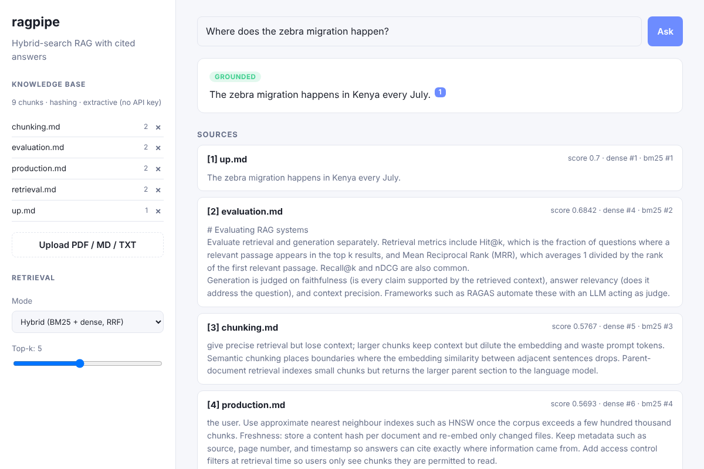

# ragpipe — Hybrid-Search RAG Pipeline with Cited Answers

A compact, production-style Retrieval-Augmented Generation pipeline: ingest documents, retrieve with **hybrid search (BM25 + dense embeddings fused with Reciprocal Rank Fusion)**, **rerank**, and generate **grounded, cited answers with Claude** — with an **evaluation harness**, **FastAPI service**, **Docker** and **CI**.

```
 docs (.md/.txt/.pdf) ─► load ─► recursive chunking (+overlap) ─► embed ─► vector store (persisted)
                                                          └────────► BM25 index
 question ─► dense top-N ┐
                         ├─► RRF fusion ─► reranker ─► top-k ─► Claude (context-only, [n] citations) ─► answer
            BM25 top-N   ┘                                         └─► "I don't know…" if unsupported
```

## Why these design choices
| Choice | Reason |
|---|---|
| Hybrid BM25 + dense | Dense catches paraphrase, BM25 catches exact IDs/acronyms; RRF fuses without score normalisation |
| Reranking stage | Cheap recall first, precise ordering second (pluggable cross-encoder) |
| Cited, context-only prompt + abstention | Reduces hallucination; every claim traceable to a source chunk |
| Pluggable embedder / reranker / generator | Offline `hashing` embedder for tests & CI; `sentence-transformers` for real semantics |
| Eval harness (Hit@k, MRR) in CI | Prevents silent quality regressions when changing chunking/models |
| Index-embedder mismatch guard | Fails loudly instead of returning garbage |



## Run the full app locally (backend + frontend)
Prereqs: Python 3.10+, Node 18+.
```bash
python -m venv .venv && source .venv/bin/activate     # Windows: .venv\Scripts\activate
pip install -e ".[dev]"
export ANTHROPIC_API_KEY=sk-ant-...                   # optional; without it answers are extractive
npm install                                           # installs root + frontend deps
npm run dev                                           # FastAPI on :8000 + React (Vite) on :5173
```
Open http://localhost:5173 — the sample docs are indexed on first start; upload your own PDF/MD/TXT from the sidebar,
switch retrieval mode (hybrid / dense / BM25), and click `[n]` citations to jump to the source passage.

## CLI / API only
```bash
pip install -e ".[dev]"            # add ".[local]" for sentence-transformers + cross-encoder
cp .env.example .env && export ANTHROPIC_API_KEY=sk-ant-...
ragpipe ingest data/docs
ragpipe ask "What does Reciprocal Rank Fusion compute?"
ragpipe eval eval/dataset.jsonl    # compares dense / bm25 / hybrid / hybrid+rerank
ragpipe serve                      # POST /ask  {"question": "...", "k": 5}
```
Without `ANTHROPIC_API_KEY` it falls back to an extractive answer so you can try everything offline.

For better retrieval: `RAG_EMBEDDER=sentence-transformers` (default `BAAI/bge-small-en-v1.5`) and re-ingest.

### Docker
```bash
docker build -t ragpipe . && docker run -p 8000:8000 -e ANTHROPIC_API_KEY ragpipe
curl -X POST localhost:8000/ask -H 'content-type: application/json' -d '{"question":"What is MRR?"}'
```

## Evaluation
`eval/dataset.jsonl` holds questions with labelled relevant sources + keywords (passage-level relevance). Output on the bundled demo corpus:

| mode | Hit@5 | MRR |
|---|---|---|
| dense | 1.00 | 0.933 |
| bm25 | 1.00 | 0.883 |
| hybrid (RRF) | 1.00 | 0.950 |

> The demo corpus is only 8 chunks, so these numbers show the harness works, not benchmark-grade quality. Point `ragpipe ingest` at your own corpus and extend the dataset to 50+ questions for meaningful numbers.

## Project layout
`frontend/` — React + Vite UI · `src/ragpipe/` — `loaders` · `chunking` · `embeddings` · `bm25` · `store` · `retriever` (RRF + rerankers) · `generator` (Claude) · `pipeline` · `evaluate` · `api` (ask, upload, stats, delete) · `cli`; `tests/` — unit + integration tests.

## Roadmap
- Swap `VectorStore` for Qdrant/pgvector (HNSW) at scale
- LLM-as-judge faithfulness metric, query rewriting, streaming responses
- Metadata filters / per-user access control at retrieval time
